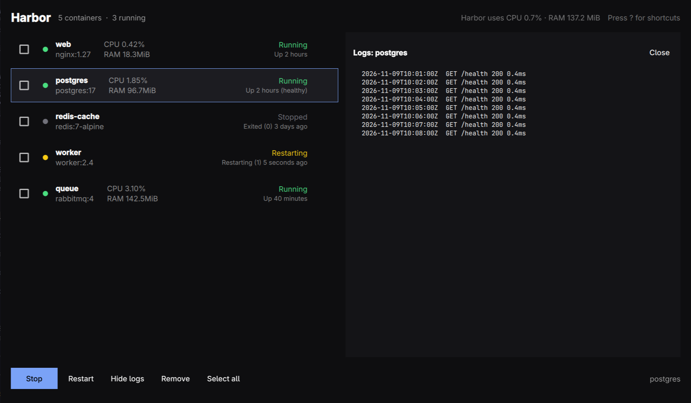
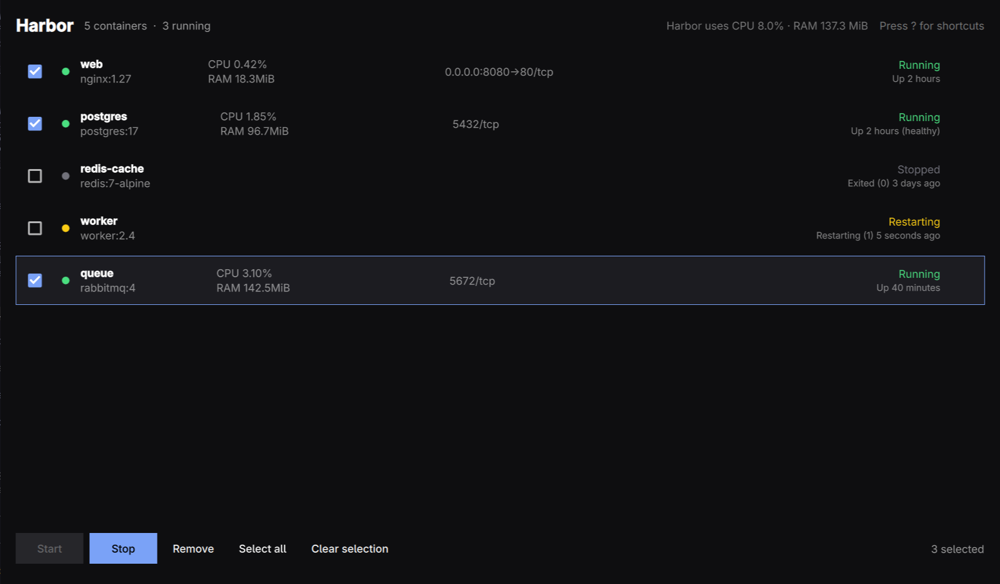
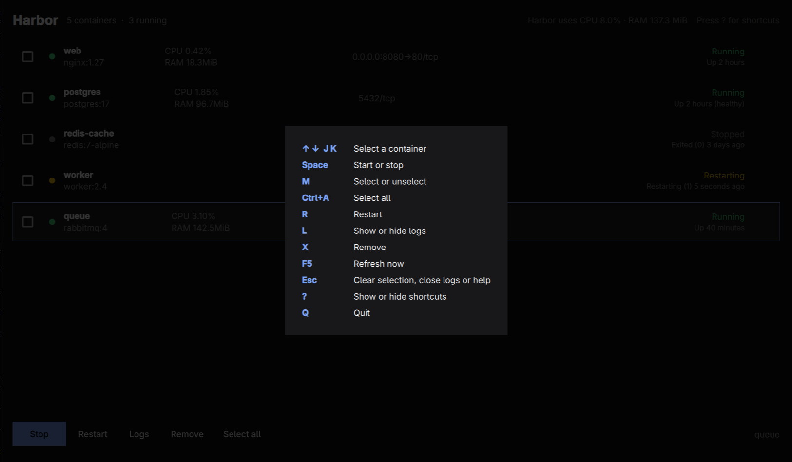
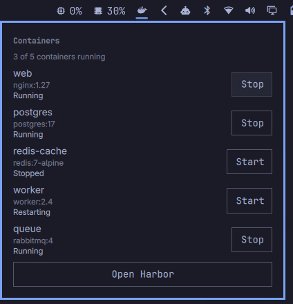

# Harbor



Harbor manages the Docker containers on this machine from one keyboard-driven
window: see every container, its state, and the CPU and memory it uses, start,
stop, restart, or remove it, and follow its logs. Select several containers to
start, stop, or remove them together. The list refreshes every three seconds.
The header shows the CPU and memory Harbor itself uses. It follows the Omarchy
theme and language.



Harbor talks to Docker through the `docker` command, so you need to be able
to run `docker ps` without sudo. If you can't, Harbor says so and tells you
how to fix it (usually `sudo usermod -aG docker $USER`, then log out and back in).

## Install

Download the package from the [latest release](https://github.com/abdulkalam1233/harbor/releases/latest)
and install it:

```sh
sudo pacman -U harbor-*-x86_64.pkg.tar.zst
```

Or build and install it from this checkout with `bin/install`.

## Shortcuts

| Key | Action |
| --- | --- |
| `↑` `↓` / `J` `K` | Select a container |
| `Space` | Start or stop (with a selection: start the stopped ones, or stop them all if all are running) |
| `M` / `Ctrl`+click | Select or unselect a container |
| `Shift`+click | Select a range |
| `Ctrl`+`A` | Select all |
| `R` | Restart |
| `L` | Show or hide logs |
| `X` / `Delete` | Remove, or remove the selection (asks first) |
| `F5` | Refresh now |
| `Esc` | Clear the selection, close logs, or close help |
| `?` | Show or hide shortcuts |
| `Q` | Quit |

Press `?` in Harbor to see them:



## Bar widget

Harbor ships an Omarchy bar widget. It shows a Docker icon whose tooltip says
how many containers are running. Click it for a panel to start and stop
containers and open Harbor. In the panel, `Tab` or the arrow keys move between
buttons, `Enter` presses one, and `Esc` closes it. It needs Omarchy's shell.



The package installs the widget to `/usr/share/harbor/omarchy-plugin`. Link it
into your Omarchy plugins and enable it:

```sh
ln -sfn /usr/share/harbor/omarchy-plugin ~/.config/omarchy/plugins/harbor.containers
omarchy plugin enable harbor.containers --before omarchy.tray
```

The bar keeps the widget it first loaded, so after upgrading Harbor run
`omarchy restart shell` to pick up the new one.

To disable it:

```sh
omarchy plugin disable harbor.containers
rm ~/.config/omarchy/plugins/harbor.containers
```

## Build

```sh
bin/build      # builds build/harbor
bin/test       # runs the app and bar widget tests offscreen
bin/install    # builds and installs the package, so it's in the app launcher
```
