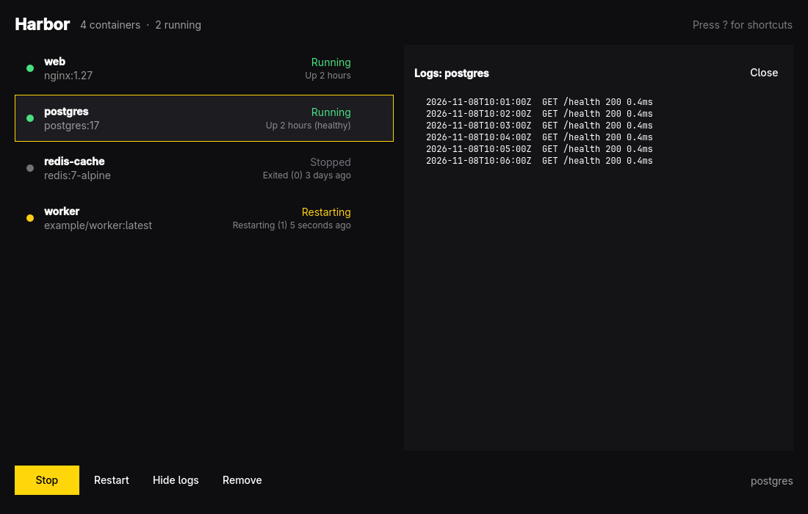

# Harbor



Harbor manages the Docker containers on this machine from one keyboard-driven
window: see every container, its state, and the CPU and memory it uses, start,
stop, restart, or remove it, and follow its logs. Select several containers to
start, stop, or remove them together. The list refreshes every three seconds.
The header shows the CPU and memory Harbor itself uses. It follows the Omarchy
theme and language.

Harbor talks to Docker through the `docker` command, so you need to be able
to run `docker ps` without sudo. If you can't, Harbor says so and tells you
how to fix it (usually `sudo usermod -aG docker $USER`, then log out and back in).

## Shortcuts

| Key | Action |
| --- | --- |
| `↑` `↓` / `J` `K` | Select a container |
| `Space` | Start or stop (with a selection: start the stopped ones, or stop them all if all are running) |
| `M` / `Ctrl`+click | Select or unselect a container |
| `Shift`+click | Select a range |
| `Ctrl`+`A` | Select all |
| `R` | Restart |
| `L` | Show or hide logs |
| `X` / `Delete` | Remove, or remove the selection (asks first) |
| `F5` | Refresh now |
| `Esc` | Clear the selection, close logs, or close help |
| `?` | Show or hide shortcuts |
| `Q` | Quit |

## Build

```sh
bin/build      # builds build/harbor
bin/test       # runs the tests offscreen
bin/install    # builds and installs the package, so it's in the app launcher
```
